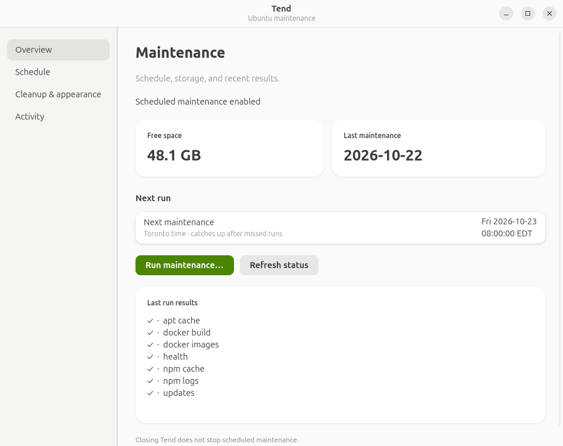
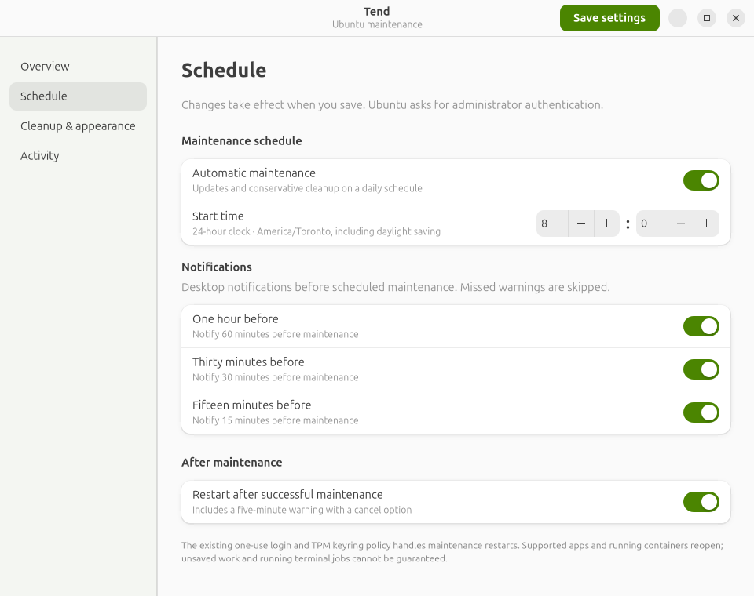

# Tend

Native Ubuntu maintenance settings, built with Rust and GTK 4.

Tend brings Ubuntu workstation maintenance into a small native desktop app. Pick a time, choose your reminders, decide whether successful maintenance should restart the computer, and see what happened. Pin it to your dock and open it when you need it.

<p align="center"></p>

## Features

| Setting | Function |
| --- | --- |
| Storage | See available disk space and the latest cleanup results. |
| Schedule | Set a time in America/Toronto; daylight saving and missed-run catch-up are handled by systemd. |
| Notifications | Independently enable reminders 60, 30, and 15 minutes beforehand. |
| Restart and restore | Keep the existing maintenance restart and app restoration policy, or turn automatic restarts off. |
| Activity | Read recent maintenance activity without opening a terminal. |

The app and its settings helper are written in Rust, using GTK 4 and libadwaita. There is no embedded browser, background app service, telemetry, or idle polling. Background maintenance belongs to systemd. Closing Tend ends the UI process.

## Current scope

**Version 0.1 is a companion to an existing `dev-maintenance` deployment.** It does not install a general-purpose maintenance engine on a new machine. The integration expects:

- `/usr/local/lib/dev-maintenance/dev-maintenance.py`, with the supported 08:00 due-window calculation;
- `dev-maintenance.service` and `dev-maintenance.timer`;
- the existing reboot helper and its warning, cancellation, login, and restoration policy;
- a GNOME desktop with Polkit, systemd, and a notification service.

The installer checks the maintenance integration before changing it. Missing or unfamiliar deployments fail with an explanation. Viewing the UI and building from source do not require root. **Saving system settings and starting maintenance require a native administrator prompt.**

## Install

Tested on Ubuntu 26.04 with GTK 4.22 and libadwaita 1.9. Built and checked with Rust 1.93. Requires GTK 4.12+ and libadwaita 1.5+.

```sh
sudo apt install cargo rustc libgtk-4-dev libadwaita-1-dev pkg-config
git clone https://github.com/jtmb/tend.git
cd tend
./scripts/install.sh
```

The installer builds one job at a time, installs the app and constrained settings helper, adds a desktop launcher, and pins Tend to the GNOME dock. It backs up the original maintenance engine under `/var/lib/tend-install` and replaces the older warning timers with Tend's equivalent system timers. It does not run maintenance or request a restart.

Open **Tend** from your dock or application launcher.

<details>
<summary><strong>See the schedule controls</strong></summary>



</details>

## What the settings do

- **Automatic maintenance:** enables or disables the maintenance timer and its reminder timers. It does not interrupt an already running maintenance job.
- **Start time:** updates both the systemd calendar and the maintenance engine's due-date calculation. The timezone is explicitly America/Toronto.
- **Reminders:** missed notifications are skipped rather than showing an incorrect countdown after wake.
- **Restart after maintenance:** controls the existing post-maintenance reboot hook. The five-minute warning and cancellation remain in that helper.
- **Appearance:** system, light, or dark; stored in the user's configuration directory.

Settings are stored in `/etc/tend/settings.json`. The root helper accepts a small typed settings object, rejects unknown fields and invalid times, writes only fixed destinations, and passes fixed commands directly to systemd without a shell. Failed application attempts restore the previous settings files and timer states. Saving is rejected while maintenance is running.

## Cleanup boundaries

Tend displays the installed maintenance engine's conservative policy. It does not add an aggressive cleaner or offer deletion of project files.

| Area | Existing policy |
| --- | --- |
| Docker | Unused build cache older than 14 days with a 5 GB allowance; dangling images only |
| npm | Weekly cache verification; old diagnostic logs cleaned |
| Python | Oversized caches reported for review; environments preserved |
| Ubuntu | Stable repository updates, obsolete APT downloads, existing temporary-file and log cleanup |
| Data | Containers, volumes, tagged images, repositories, and project dependencies preserved |

App restoration relies on the existing desktop restoration helper and each application's own recovery support. Unsaved documents and running terminal jobs are not guaranteed to survive a reboot. TPM keyring enrollment and one-use automatic login belong to that existing system policy; Tend never reads or stores the keyring password.

## Develop

```sh
cargo check --locked -j 1
cargo test --locked -j 1
cargo run --locked
```

`src/main.rs` contains the native UI; `src/bin/tend-admin.rs` is the constrained privileged helper; `src/lib.rs` defines settings validation. The Python installer only connects those binaries to the existing maintenance deployment.

Builds use a stripped release profile with size optimization. On the development machine, the release UI executable was approximately 637 KiB. One ten-second idle sample recorded no CPU ticks, about 79 MiB proportional memory (PSS), and 139 MiB resident memory (RSS). These are a single-session observation with the default renderer, not a cross-machine benchmark; shared GTK libraries and graphics drivers affect memory use. Closing the last window releases the UI process.

An optional GitHub Actions template is provided in [`docs/github-actions-check.yml`](docs/github-actions-check.yml). It is not installed as an active workflow; copy it to `.github/workflows/check.yml` using a GitHub identity with workflow permission if desired.

## Uninstall

```sh
pkexec /usr/bin/python3 "$PWD/scripts/uninstall.py"
```

This removes Tend’s binaries, launcher, timer overrides, and settings, restores the original maintenance schedule and warning timers, and preserves maintenance reports. Unpin Tend from the dock afterward. Uninstall Tend before removing or rolling back the underlying maintenance engine or reboot hook, so its timer overrides do not remain behind.

## License

[MIT](LICENSE). Contributions that keep the interface clear and the background footprint small are welcome.
