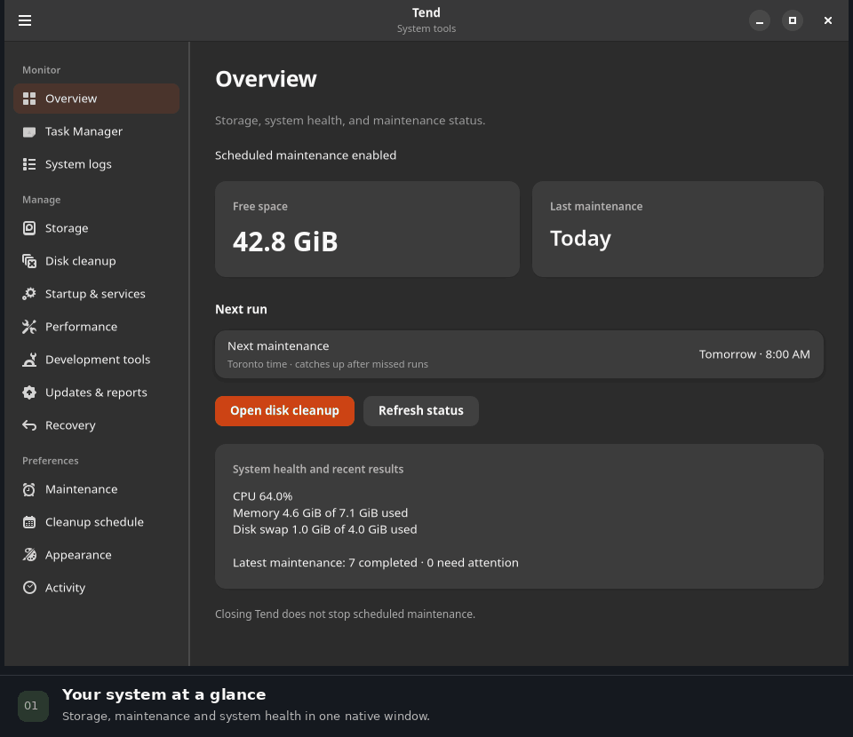
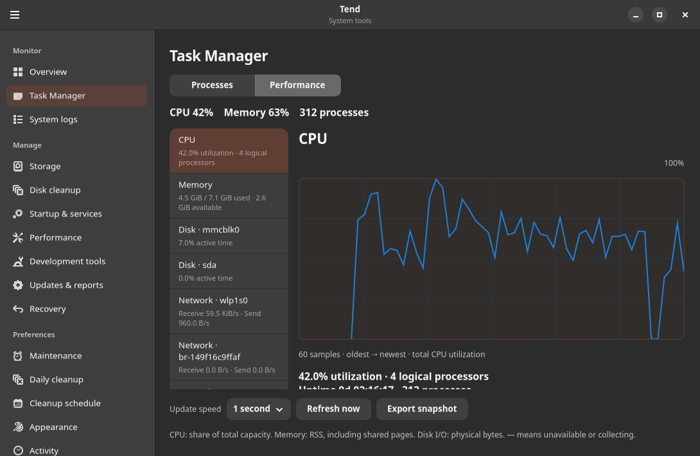
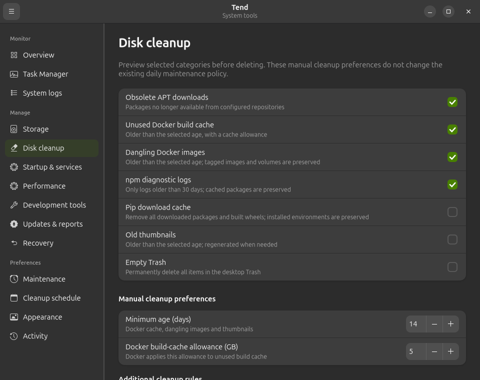
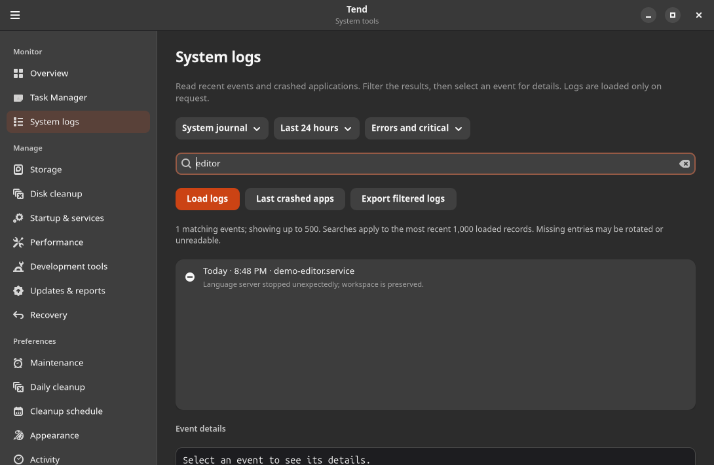
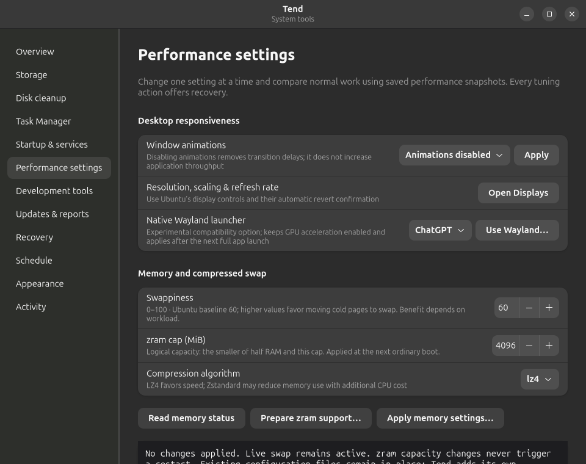

<p align="center">
  
</p>

<h1 align="center">Tend</h1>

<p align="center"><strong>Disk cleanup, live performance charts, system logs and practical Ubuntu settings.</strong></p>
<p align="center">Native Rust · GTK 4 &amp; libadwaita · Ubuntu / GNOME · <a href="LICENSE">MIT licensed</a></p>

<p align="center">
  <a href="#features">Features</a> ·
  <a href="#screenshots">Screenshots</a> ·
  <a href="#install">Install</a> ·
  <a href="docs/USER_GUIDE.md">User guide</a> ·
  <a href="https://github.com/jtmb/tend/issues">Report an issue</a>
</p>

| Native interface | Preview before cleanup | Local and private |
| :--- | :--- | :--- |
| Rust and real GTK widgets. No embedded browser. Monitoring pauses in the background. | Inspect eligible files, set age limits and choose what gets cleaned. | No telemetry or advertising. Reports stay on your computer unless you share them. |

<p align="center">
  <a href="assets/demo.gif"></a>
</p>

<p align="center"><sub>A 32-second tour of the native app · live resource counters · no cleanup or settings changes performed.<br>Prefer still images? <a href="#screenshots">Browse the screenshot gallery.</a></sub></p>

## Features

| | |
| :--- | :--- |
| **Live Task Manager**<br>Search and sort processes. Follow CPU, memory, disk and network graphs. Inspect a process or request that it quit. | **Disk explorer & cleanup**<br>Find large files, inspect Docker storage and preview cache cleanup. Add folder rules with filename patterns, minimum ages and optional recursion. |
| **System logs & recent crashes**<br>Read system and application events. Filter by time, severity or text, select an event for details and export the results. | **Developer maintenance**<br>Inspect Docker cache and log sizes, verify npm’s cache and review Python downloads. Containers, volumes and tagged images are preserved by Docker cleanup. |
| **Useful performance controls**<br>Manage login apps, desktop animations, Wayland launcher overrides, swappiness and future-boot zram settings. Restore supported changes through Recovery. | **Cleanup schedules**<br>Choose daily, weekly or custom cron schedules. Catch up after missed runs, avoid overlapping jobs and review the last result. New schedules start disabled. |

### Built to stay lightweight

- **Work happens on request.** No folder scan, Docker query or package refresh runs when you open Tend.
- **Monitoring follows your attention.** Two-second sampling by default, only with Task Manager selected and Tend focused. Choose pause, 1, 2 or 5 seconds.
- **Bounded resource use.** Native process-list virtualization, 60-sample graphs, limited log reads and one resource collection at a time.
- **Clear controls.** Close to the dock when enabled; dock Quit and **Quit Tend** exit. Existing scheduled maintenance works independently of the window.

Tend helps you identify bottlenecks and compare changes. A tuning setting is not presented as a proven speedup without measurements on your workload.

## Screenshots

<table>
  <tr>
    <td width="50%"><strong>Performance at a glance</strong><br>CPU, memory, disk and network views.<br><br><a href="assets/task-manager.png"></a></td>
    <td width="50%"><strong>Cleanup you can inspect</strong><br>Choose categories and review eligibility.<br><br><a href="assets/cleanup.png"></a></td>
  </tr>
  <tr>
    <td width="50%"><strong>Readable system logs</strong><br>Time, source, severity and text filters.<br><br><a href="assets/system-logs.png"></a></td>
    <td width="50%"><strong>Practical system settings</strong><br>Desktop and memory controls in one place.<br><br><a href="assets/performance.png"></a></td>
  </tr>
</table>

Screenshots show the native application. Resource readings are snapshots, not benchmark results.

## Install

**Current scope:** Tend 0.2 integrates with an existing Ubuntu/GNOME `dev-maintenance` deployment and its trusted Tend helper. It does not yet provision that maintenance engine on a fresh machine. Check the [integration prerequisites](docs/USER_GUIDE.md#install-or-upgrade) first.

### Build and install the interface

Requires Rust, GTK 4.12+ and libadwaita 1.5+ development packages.

```sh
sudo apt install cargo rustc libgtk-4-dev libadwaita-1-dev pkg-config
git clone https://github.com/jtmb/tend.git
cd tend
./scripts/install.sh
```

The installer builds with one job, then installs the user interface, user cleanup worker, icon and dock launcher. **Routine interface updates do not invoke sudo or pkexec.** A missing trusted helper produces an explanation instead of opening an authentication prompt.

Open **Tend** from the application launcher and pin it to the dock. On an existing install, choose **Quit Tend** before reopening to use an updated binary.

### Upgrade an existing checkout

```sh
git pull --ff-only
./scripts/install.sh
```

Installation does not enable new cleanup schedules or change the existing maintenance/restart policy. See the [user guide](docs/USER_GUIDE.md) for first-time helper authorization, recovery and uninstall instructions.

## Cleanup and tuning, with visible boundaries

| Action | What to expect |
| :--- | :--- |
| **Manual cleanup** | Preview and confirmation first. Built-in cache categories and additional folder rules are separate from the existing daily maintenance policy. Deletion is permanent. |
| **Docker cleanup** | Old unused build cache and dangling images only. Docker determines eligibility at execution. Containers, networks, volumes and tagged images are preserved. |
| **Folder rules** | User-owned folders, filename patterns and minimum ages. Symlinks, other filesystems and protected repository/dependency paths are excluded. |
| **Scheduled cleanup** | Explicitly enable it after reviewing the saved policy. Jobs run as your user, preserve unrelated cron entries and never request updates or a reboot. |
| **System actions** | A constrained, root-owned helper handles supported privileged operations. Tend never saves your login password. |
| **Memory settings** | Swappiness can apply immediately. Zram configuration takes effect at a future ordinary boot; no live swapoff or restart is performed. |

The existing system maintenance schedule is separate and may include its own configured restart policy. Tend’s manual cleanup and independent updater do not invoke that restart hook.

## Documentation

- [User guide](docs/USER_GUIDE.md) — every page, cleanup policy, scheduling, permissions, recovery and uninstall.
- [Implementation notes](docs/IMPLEMENTATION.md) — architecture, operation boundaries and delivery checks.
- [Demo recording](docs/demo/README.md) — reproduce the native walkthrough without touching an installed session.
- [Source](src/) — native UI, collectors, user worker and constrained system helper.
- [Issues](https://github.com/jtmb/tend/issues) — bugs and feature requests. Review logs before posting; they can include private paths and application names.

## Contribute

Bug reports, focused fixes and documentation improvements are welcome. For a bug, include Ubuntu/GNOME versions, how Tend was installed and steps to reproduce. Share only relevant, redacted log excerpts.

```sh
cargo fmt
cargo build --locked -j 1
```

Keep changes native, responsive and modest in resource use. Avoid automatic scans, unsolicited system changes and extra background services. Explain behavior changes and how you checked them in your pull request.

## License

[MIT](LICENSE). Tend is free and open-source software.
